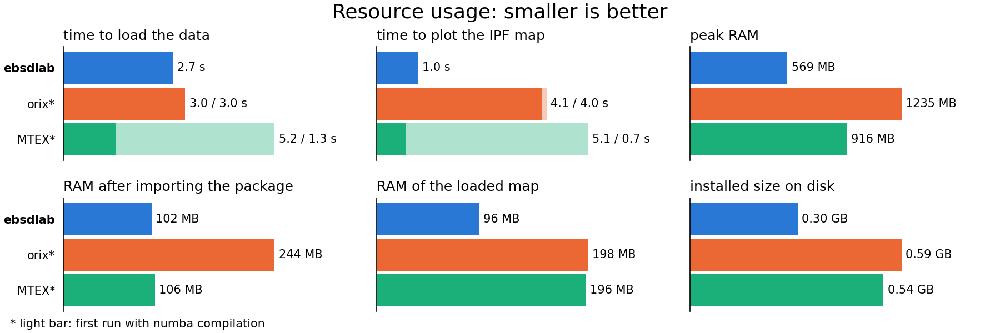

.. encoding: utf-8 -*-
.. _comparisonOrix:
.. _comparisonLibraries:

Comparison with orix and MTEX
=============================

`orix <https://orix.readthedocs.io>`_ is a Python library for crystal orientation analysis;
`MTEX for Python <https://mtex-toolbox.github.io>`_ (``pip install mtex``) is the Python version of the MATLAB
texture toolbox. This page compares orix 0.15.0 and MTEX for Python 1.0.0 with ebsdlab.

Features
--------

.. list-table::
   :header-rows: 1
   :widths: 16 28 28 28

   * -
     - ebsdlab
     - orix
     - MTEX for Python
   * - file formats
     - ``.ang``, ``.ctf``, ``.osc``, ``.crc``/``.cpr``, EDAX ``.h5``, ``.txt``
     - ``.ang``, ``.ctf``, Bruker and EMsoft h5ebsd, orix HDF5
     - ``.ang``, ``.ctf``, ``.osc``, ``.crc``/``.cpr``, HDF5 of Bruker, EDAX, Oxford, Thermo Fisher and EMSphInx;
       not EDAX ``.h5`` written by OIM 7.3 (keys start with a space), e.g. ``CPTi.h5`` of the tests
   * - hexagonal scan grids
     - load, maps and neighbor analysis
     - load only, no maps
     - load, maps and neighbor analysis
   * - crystal symmetry
     - Laue groups of the seven crystal systems
     - all 32 point groups, space groups via diffpy.structure
     - all 32 point groups
   * - maps
     - IPF, CI, IQ and other scalar maps, unit-cell overlays, scale bars
     - IPF and property maps
     - IPF and property maps, many color keys
   * - pole figures and texture
     - pole figures with the pole density in multiples of random (mrd)
     - pole figures and pole density functions
     - pole figures, ODFs from EBSD and from pole-figure data, texture characteristics
   * - KAM and grains
     - KAM, grain reconstruction, grain dilation
     - –
     - KAM, grains and grain boundaries, denoising, parent grain reconstruction
   * - graphical user interface
     - ``ebsdlab-gui``: maps, pole figures, filters, unit-cell overlays, copies the Python code
     - –
     - import wizard that writes the import script
   * - speed and memory
     - see `Resource usage`_
     - see `Resource usage`_
     - see `Resource usage`_
   * - installed packages
     - 12 (see `Dependencies`_)
     - 41
     - 4, or 16 with the numba, plot and io extras

- **ebsdlab**: large maps on little memory, hexagonal scans and quick looks.
- **orix**: a rich data model (quaternions, rotations, orientations, misorientations), all point and space groups.
- **MTEX for Python**: the widest analysis (grains, boundaries, ODFs, parent grains), with the syntax of MATLAB MTEX.

Resource usage
--------------

Each package loads an ``.ang`` file with 1.6 million points and plots its IPF map along Z.

Once numba has compiled, MTEX is the fastest; on the first run after an installation, the compilation makes it the
slowest. ebsdlab needs no compilation, the least RAM (half of orix, 60 % of MTEX) and the least disk space: it stores the
map as ``float16`` and folds each pole directly into the standard triangle.

Details: measured on 2026-10-21 with ebsdlab 1.0, orix 0.15.0 and MTEX for Python 1.0.0 (``mtex[numba,plot,io]``),
Python 3.14.4, numpy 2.5.4, scipy 1.18.1 and matplotlib 3.11.2, on a laptop (AMD Ryzen 5 3500U, 14 GB). Each package
has its own virtual environment and each measurement its own process; the first run starts from an empty numba
cache, and three repetitions agree within 0.2 s. orix and MTEX use the TSL color key. Peak RAM includes the imports;
the RAM of the loaded map is the size of all its arrays. The file is ``EBSD_deformed_I_ED.ang`` of Maj et al. (Zenodo
18668585, 190 MB). orix cannot plot hexagonal grids, so every second row is shifted by half a step to make the grid
rectangular; on the original hexagonal file, ebsdlab and MTEX are as fast.

Dependencies
------------

.. list-table::
   :header-rows: 1

   * - package
     - direct dependencies
     - total installed
   * - **ebsdlab**
     - 3 (numpy, scipy, matplotlib)
     - 12
   * - **ebsdlab[gui]**
     - 4 (adds PySide6)
     - 16
   * - **orix 0.15.0**
     - 11
     - 41
   * - **mtex 1.0.0**
     - 3 (numpy, scipy, finufft)
     - 4
   * - **mtex[numba,plot,io] 1.0.0**
     - 6 (numpy, scipy, finufft; extras numba, matplotlib, h5py)
     - 16
